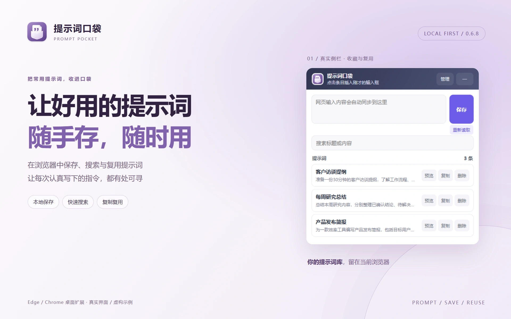
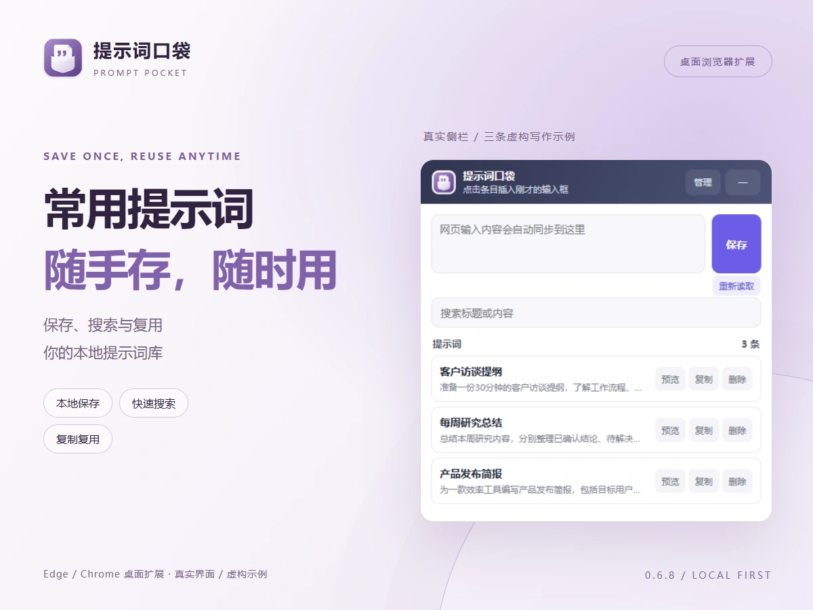
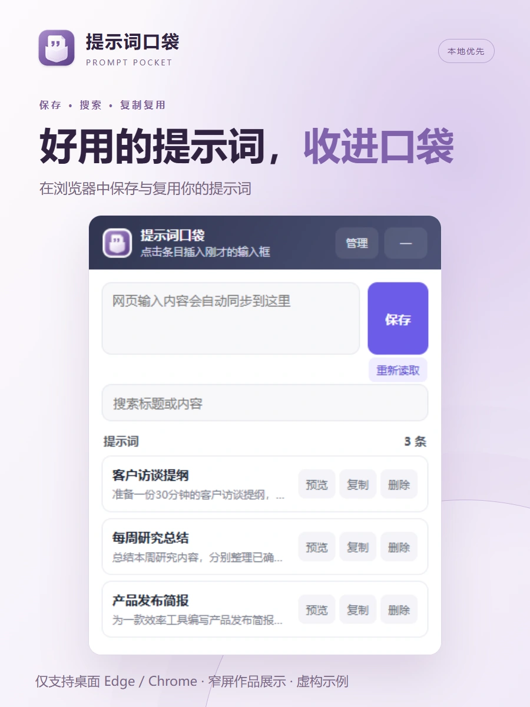
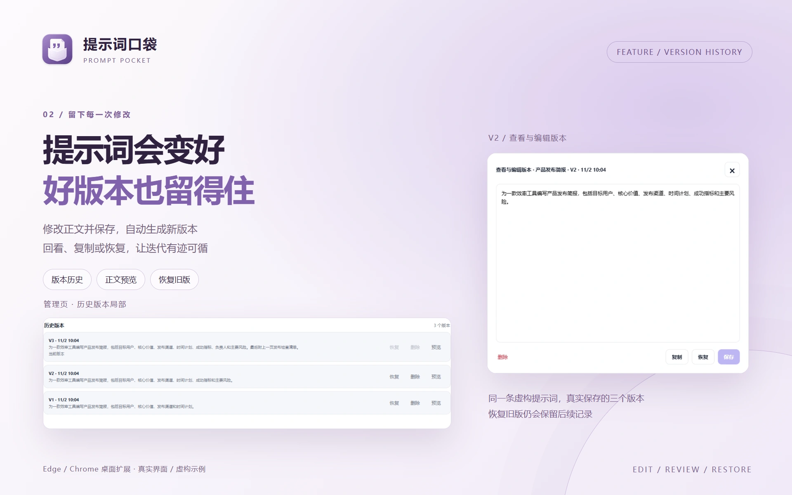

# 提示词口袋 · 造物集正式素材

2026-11-02，产品 ID：`prompt-pocket`。仓库：[liaoyiming222-art/prompt-pocket](https://github.com/liaoyiming222-art/prompt-pocket)，分支 `main`。实际运行界面代码版本：`a6d00f93e73377ddfda8d37958573df73872559d`，扩展版本 0.6.8。素材固定提交以收录本目录的 Git 提交为准，manifest 不写入自身提交哈希，以免循环引用。

## 交付

| 文件 | 尺寸 | 用途 |
| --- | --- | --- |
| [icon.svg](icon.svg) | viewBox 256×256 | 沿用现有正式图标，和 `../../icons/brand.svg` 完全一致 |
| [icon-512.png](icon-512.png) | 512×512 | 透明背景产品图标 |
| [hero.webp](hero.webp) | 1920×1200 | 首页展台，左右图文构图 |
| [card.webp](card.webp) | 1200×900 | 作品卡片，重新安排标题、功能与界面 |
| [mobile.webp](mobile.webp) | 900×1200 | 窄屏作品集，独立竖向构图 |
| [detail-01.webp](detail-01.webp) | 1920×1200 | 关键功能：版本历史及 V2 正文预览 |



 



## 真实性与范围

先检查 README、仓库资料、品牌交接说明、扩展 manifest、管理页、侧栏、后台数据逻辑和历史拍摄脚本。项目没有发现额外 AGENTS.md 开发约定。正式图标直接沿用现有母版，未改产品图标、代码、部署或权限。

本次实际加载项目根目录的未打包扩展，运行于全新临时 Edge 配置；使用真实 Chrome 扩展存储、后台处理和消息机制，**没有使用旧品牌工作台的 HTTP/API 模拟桥**。通过真实 `handleDataMessage` 创建三条虚构写作提示词，并将「产品发布简报」正文实际修改两次，得到 V1/V2/V3。界面上的日期和版本号由运行中的产品产生，没有重画或替换界面内容。所有正文都是提示词示例，不是 AI 生成结果或真实客户资料。

侧栏截图来自扩展协议的 `sidebar.html` 页面，使用其真实宽度布局，不包含浏览器原生侧栏外壳。拍摄仅将封闭 Shadow DOM 改为可检查模式，便于确认三条条目已渲染；未改变 UI、样式、存储或消息。`captures/` 保留原图和管理页历史区的无修饰矩形裁切。宣传图仅在截图外排版，截图保留产品原有的截断省略显示；没有替换按钮、伪造统计或输出。

真实能力包括本地保存、搜索、复制、向常规网页输入框插入、正文版本历史、JSON 备份及中英文界面。仅支持桌面 Edge / Chrome、Chromium 142+。没有账号、云同步、AI 生成或分类、标签、文件夹、模板变量；iframe 和受保护页面不可读写，复杂编辑器可能只能复制。`mobile.webp` 是供手机浏览作品集的宣传排版，**不代表手机安装插件**。本次确认列表、三个版本及 V2 预览，不代表商店安装或所有网页插入全回归。

## 可复现制作

在本目录安装 `package.json` 声明的免费本地依赖 Playwright 1.62.1 与 sharp 0.35.5，使用 Node.js 24。默认使用 Windows 标准安装位置的 Edge；其他环境用 `BROWSER_PATH` 指定支持加载未打包扩展的 Chromium 浏览器。已有依赖时可设置 `PORTFOLIO_MODULES` 指向依赖目录，无需修改源码。构建、HTML 与图片均不依赖本机项目绝对路径或外站热链。

```sh
npm install
npm run capture
npm run build
npm run verify
npm run build
npm run verify
```

首次 `verify` 生成尺寸检查图，第二次 `build` 将这些证据的哈希收入 manifest；最终 `verify` 核对清单。仅重新排版可直接运行 `build` 与 `verify`，无需重新拍摄。重新拍摄需要检出上面的界面代码提交；如果使用了其他代码，拍摄记录会写入新的 HEAD。临时浏览器配置在拍摄结束时删除，不读取或更改日常浏览器数据。

`layout.html` 是共用排版源文件，`build.mjs` 包含四种独立构图的内容；`hero.html`、`card.html`、`mobile.html`、`detail-01.html` 是可直接离线打开的自包含排版成品，内嵌所有图片。字体为本地 Microsoft YaHei / PingFang SC / sans-serif，未嵌入有版权限制的系统字体；不同系统字体可能带来微小排版差异，交付 WebP 为固定像素成品。本次没有调用生成服务或其他付费服务。

## 检查与接入

四张图均检查完整尺寸、960px 桌面展示和 390px 手机展示；窄屏入口应选择 `mobile.webp`，横版缩到手机宽度时仅供整体识别，界面小字请打开原图查看。确认标题和核心用途清晰、截图没有拉伸或关键按钮裁断、装饰位于截图后方；详情图标签与正文无重叠。32/40px 图标分别在明暗背景检查，口袋轮廓与引号可辨，透明边缘完整。原产品界面的次要文字沿用真实样式，没有为宣传更改对比度。

尺寸、格式、SHA-256 和中文 alt 等机器可读信息见 [manifest.json](manifest.json)，自动检查结果见 [verification.json](verification.json)，原始拍摄记录见 [captures/record.json](captures/record.json)。每张交付图及辅助检查图都有相对路径和制作来源。

造物集按最终回复提供的固定素材提交读取本目录即可；本次没有修改造物集仓库。安装、使用与隐私说明继续保留在项目根 README。远端上传状态以最终回复的验证结果为准，生成素材并不代表已上传。
